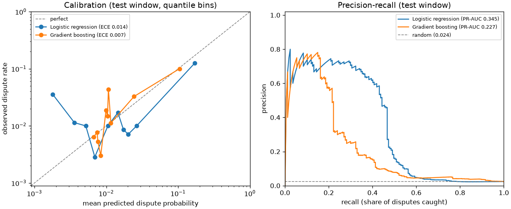
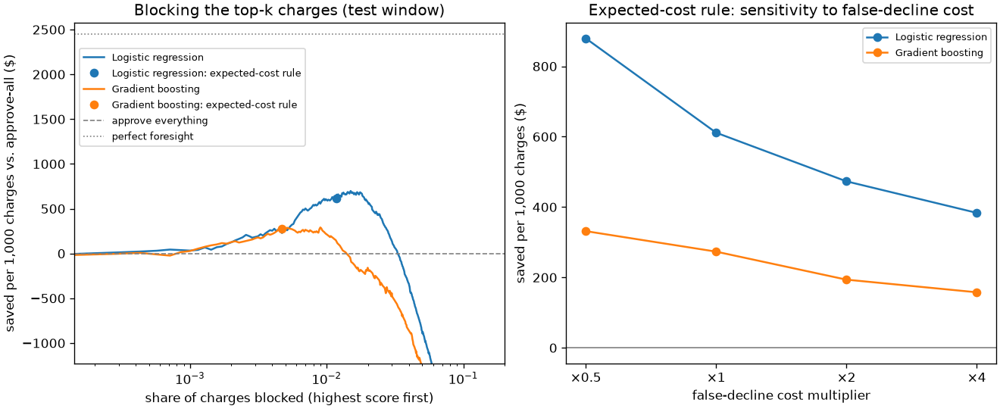

# chargeback-prediction

[](https://github.com/sidchi/chargeback-prediction/actions/workflows/ci.yml)

An ML + LLM pipeline that scores card-not-present transactions for **chargeback (dispute) risk**,
explains each score, and drafts a representment strategy when a dispute does land.

> **All data in this repository is synthetic.** No real cardholder, merchant or employer data is
> used anywhere — not in code, fixtures, notebooks or docs.

## The problem

For subscription and other card-not-present merchants, a chargeback costs far more than the
refunded amount: a network fee ($15–$100), operational time to fight it, and — above roughly a
1% dispute ratio — enrollment in network monitoring programs (Visa VDMP/VFMP, Mastercard ECM)
with escalating fines. Much of the volume is **friendly fraud**: the real cardholder forgot a
renewal or didn't recognise a descriptor and filed "fraud" (Visa 10.4) or "cancelled recurring"
(Visa 13.2) instead of contacting the merchant.

Two decisions benefit from a good risk score:

1. **Before the charge** — should a renewal be retried, sent a pre-billing reminder, routed for
   step-up authentication, or skipped?
2. **After the dispute** — is it worth representing, and what evidence wins under this reason code?

A score alone isn't actionable for an ops analyst, so every prediction comes with the factors
that drove it and a plain-language rationale.

## Architecture

```
                 ┌────────────────────┐
                 │ Synthetic generator│  customers, subscriptions, transactions,
                 │   (item 2)         │  disputes with Visa/MC reason codes
                 └─────────┬──────────┘
                           ▼
                 ┌────────────────────┐
                 │ Feature pipeline   │  velocity, account age, card-on-file updates,
                 │   (item 3)         │  retry history, geo/BIN mismatch, prior disputes
                 └─────────┬──────────┘
                           ▼
      ┌────────────────────┴───────────────────┐
      ▼                                        ▼
┌──────────────┐   time-split eval    ┌──────────────────┐
│ Models       │ ───────────────────▶ │ Evaluation       │  PR-AUC, precision@k,
│ LR + GBM (4) │                      │ report (9)       │  calibration, cost-weighted
└──────┬───────┘                      └──────────────────┘
       ▼
┌──────────────┐     ┌──────────────────┐     ┌──────────────────────┐
│ SHAP per     │ ──▶ │ LLM reasoning    │ ──▶ │ Representment        │
│ prediction(5)│     │ layer (6)        │     │ evidence packet (7)  │
└──────────────┘     └──────────────────┘     └──────────────────────┘
       │                      │
       └──────────┬───────────┘
                  ▼
        ┌────────────────────┐
        │ FastAPI /score,    │
        │ /explain  (8)      │
        └────────────────────┘
```

Numbers in parentheses map to items in [ROADMAP.md](ROADMAP.md).

### Design choices so far

- **Reason codes are a typed catalog** (`chargeback_prediction.reason_codes`), not strings
  scattered across modules. The generator, model features and evidence assembler all key off the
  same `ReasonCode` objects, normalised into `fraud` / `consumer` / `processing` categories so
  models can generalise across networks.
- **Time-based splits only** (from item 4): disputes arrive 30–120 days after the charge, so a
  random split leaks the future and overstates performance.
- **LLM is an explainer, not the scorer or the decider**: the calibrated model owns the
  probability, a rule-based playbook owns which representment strategies are allowed, and the
  LLM writes the rationale behind a provider-agnostic interface that is mocked in tests (item 6).

## Getting started

Requires [uv](https://docs.astral.sh/uv/) (it will fetch Python 3.12 if needed).

```bash
uv sync                 # create .venv and install dev dependencies
uv run cbp reason-codes # list the dispute reason codes the pipeline models
uv run cbp generate     # write a synthetic dataset to data/synthetic/*.csv
uv run cbp features     # build the point-in-time feature table at data/features.csv
uv run cbp train        # fit baselines, write report + calibration plot to artifacts/baseline/
uv run cbp evaluate     # cost-weighted evaluation + model card (artifacts/evaluation/)
uv run cbp explain      # SHAP importance + top factors for the riskiest test rows (artifacts/explain/)
uv run cbp explain --model gbm --transaction-id txn_00036179   # one-paragraph explanation
uv run cbp reason --transaction-id txn_00025755  # rationale + representment strategy for a dispute
uv run cbp playbook     # backtest the representment playbook against the synthetic ground truth
uv run cbp evidence --dispute-id dp_0000507  # draft representment packet for one dispute
uv run cbp evidence     # readiness of every dispute's packet, per reason code
uv run cbp serve        # HTTP scoring service: /v1/score, /v1/explain, docs at :8000/docs
```

Or skip the setup and run the service in Docker (it trains on synthetic data at build time):

```bash
docker build -t chargeback-prediction . && docker run --rm -p 8000:8000 chargeback-prediction
curl -s localhost:8000/v1/score -H 'Content-Type: application/json' -d @examples/score_request.json
```

## Synthetic data

`cbp generate` (or `chargeback_prediction.synthetic.generate()`) simulates a card-not-present
subscription merchant. It is seeded and pure-stdlib, so the same `--seed` always produces the
same dataset. The default run (5,000 customers over 540 days) yields about 40k authorizations
and a ~1.7% dispute rate, roughly half of it friendly fraud.

| Table | One row per | Notable columns |
|---|---|---|
| `customers` | account | `created_at`, `email_domain_type`, `card_bin`, `bin_country`, `persona`* |
| `subscriptions` | subscription | `plan` (monthly/annual), `price_cents`, `cancel_requested_at` |
| `transactions` | authorization attempt | `kind` (initial/renewal/one_off), `attempt`, `approved`, `decline_code`, `ip_country` |
| `card_updates` | card-on-file change | `source` (account_updater/customer) |
| `disputes` | chargeback | `reason_code`, `category`, `filed_at`, `is_friendly_fraud`* |

\* Ground-truth labels for slicing evaluation results. **Never use them as features.**

Four hidden personas generate the patterns the model has to learn:

| Persona | Behaviour | Typical codes |
|---|---|---|
| good | Pays; rare genuine "not received" disputes | 13.1 / 4853 |
| forgetful | Stops using the product, card gets reissued via account updater, disputes the renewal. 25% actually cancelled and were billed anyway (a *legitimate* dispute) | 13.2 / 4853, some 10.4 / 4837 |
| serial disputer | Repeatedly claims fraud or non-receipt on their own one-off orders | 10.4 / 4837, 13.1 / 4853 |
| fraudster | Stolen card: new account, disposable email, card-testing declines, IP vs. BIN country mismatch, purchase burst within 72h | 10.4 / 4837 |

Renewals retry soft declines (`51`, `05`) with fixed spacing and stop on a hard decline (`54`).
Disputes are only emitted if **filed** inside the window, mirroring production label
censoring: the newest transactions have not had time to be disputed yet.

## Features

`cbp features` (or `chargeback_prediction.features.build_features()`) reads the CSV tables
back with `read_dataset` and emits **one row per approved transaction** with 30 numeric
features plus labels. The full documented table is in [docs/features.md](docs/features.md);
it is rendered from the catalog in `features/spec.py`, and a test fails if the two drift.

| Group | Examples |
|---|---|
| transaction | `amount_usd`, `is_renewal`, `attempt` (retry number) |
| account | `account_age_days`, `email_disposable` |
| geo / BIN | `ip_bin_mismatch`, `billing_bin_mismatch`, `ip_missing` |
| velocity | `attempts_1h/24h/7d`, `declines_24h/30d`, `approved_usd_24h` |
| card on file | `au_updates_90d` (account-updater reissues), `days_since_card_update` |
| subscription / retry | `prior_subscription_declines`, `charged_after_cancel_request` |
| prior disputes | `prior_disputes`, `prior_fraud_disputes`, `days_since_last_dispute` |

**Point-in-time correctness is the main design constraint.** Each customer's and
subscription's events are indexed into sorted timelines with prefix sums, and every query asks
for events in `[t - window, t)`: nothing at or after the charge is visible. Prior-dispute
features count disputes by **filing** date — a dispute on last month's charge that is filed
next week is not something the merchant knew at authorization, and counting it by charge date
is the most common leak in chargeback models. The default dataset (~37k rows) builds in under
a second in pure Python.

**Label censoring is explicit.** `label_mature` is true only once the 120-day dispute window
has fully elapsed before the snapshot (`observed_until`). Recent rows with `disputed = false`
are "not yet", not "no", and the time-based split in item 4 trains on mature rows only.

Univariate lift on the default dataset (mature rows, base dispute rate 1.9%) confirms each
planted pattern survives the pipeline as signal:

| Feature | Share of rows | Dispute rate | Lift |
|---|---|---|---|
| `charged_after_cancel_request` > 0 | 0.2% | 86.4% | 45× |
| `declines_24h` > 0 | 0.3% | 68.8% | 36× |
| `email_disposable` > 0 | 0.5% | 66.9% | 35× |
| `prior_fraud_disputes` > 0 | 0.5% | 31.4% | 17× |
| `ip_bin_mismatch` > 0 | 1.5% | 24.8% | 13× |
| `au_updates_90d` > 0 | 2.5% | 7.4% | 4× |

## Baseline models

`cbp train` (or `chargeback_prediction.modeling.train_baselines()`) fits two baselines and
evaluates them on a held-out **future** window. The full generated report, including
reliability tables, is in [docs/baseline/report.md](docs/baseline/report.md).

**The split mirrors what you'd know on the day you train.** Disputes arrive up to 120 days
after the charge, so on a given training date only charges older than that have final labels:

```
──────── train ────────┤◀── 120-day label gap ──▶├──────── test ────────▶ time
                   train_end                  cutoff
```

Test is the newest 25% of mature rows; train is mature rows created more than 120 days before
the test window starts, so every training dispute was filed before the first test charge.
Rows in the gap and rows whose window is still open are dropped. Setting `--gap-days 0`
shows how much an un-gapped split overstates performance (logistic regression PR-AUC
0.345 → 0.367 on the default data).

| Model | PR-AUC | Lift | Precision @ top 1% | Recall @ top 5% | ECE |
|---|---|---|---|---|---|
| Logistic regression (log1p + scaled, L2) | 0.345 | 14.5× | 71% | 47% | 0.014 |
| Gradient boosting (depth 3, heavy L2) | 0.227 | 9.5× | 51% | 37% | 0.007 |
| Random scorer | 0.024 | 1.0× | 2.4% | 5% | — |



Things worth noticing:

- **The linear model wins.** The training window has only ~240 disputes and the planted
  signals are mostly monotone flags (disposable email, IP/BIN mismatch, charge after a cancel
  request), which is exactly where a regularised logistic regression is hard to beat. The GBM
  is level at the very top of the queue but falls away by 1%; its hyperparameters were set
  conservatively up front rather than tuned on the test window. Cross-validated tuning is a
  later step.
- **No class re-weighting**, so probabilities stay calibrated (ECE ≈ 1%): the retry and
  representment decisions downstream multiply the score by dollars, so a 0.3 has to mean 30%.
- **The lowest-scored decile is not the safest.** Logistic regression's bottom bin has a 3.6%
  observed rate against 0.2% predicted: "looks perfectly normal" disputes sit where the model
  is most confident. SHAP (below) shows why.
- **Metrics are hand-rolled in NumPy** (`modeling/metrics.py`) with explicit tie handling and
  quantile calibration bins, and cross-checked against scikit-learn in the tests.

## Evaluation report

`cbp evaluate` (or `chargeback_prediction.evaluation.run_evaluation()`) asks the question the
metrics above don't: **what is acting on the score worth in dollars, and how sure are we?**
Generated outputs: [cost report](docs/evaluation/report.md),
[model card](docs/evaluation/model_card.md), and a walkthrough notebook with charts,
[notebooks/evaluation.ipynb](notebooks/evaluation.ipynb).

Each test charge lands in one of four cells. The two mistakes have different prices, and both
scale with the amount:

| | disputed | not disputed |
|---|---|---|
| **blocked** | dispute avoided (action cost) | false decline: lost margin + churn × LTV |
| **approved** | chargeback: unrecovered amount + fee + ops | normal sale |

With calibrated probabilities the cheapest decision needs no tuned threshold: block when
`p · C_chargeback(amount) > (1 − p) · C_false_decline(amount) + C_action`. That rule is
compared against approving everything, a fixed 1% review budget, the best single threshold
*chosen in hindsight* (an unattainable upper bound for any threshold) and perfect foresight.
Dollar assumptions are illustrative defaults in `CostModel`, all overridable from the CLI
(`--dispute-fee`, `--margin`, `--ltv`, ...).

| Model | PR-AUC (95% CI) | Saved per 1k charges (95% CI) | Blocked | Share of achievable saving |
|---|---|---|---|---|
| Logistic regression | 0.345 [0.269, 0.431] | $611 [$360, $850] | 1.2% | 24.9% |
| Gradient boosting | 0.227 [0.163, 0.301] | $273 [$117, $437] | 0.5% | 11.1% |



- **Intervals, not point estimates.** The test window has 167 disputes, so every headline
  number carries a stratified bootstrap interval (resampling within disputed and undisputed
  rows keeps the base rate fixed, which PR-AUC depends on). The model comparison uses a
  *paired* bootstrap on the same resampled rows: logistic regression beats GBM by +0.118
  PR-AUC [+0.047, +0.194] and $338 per 1k charges [$120, $558], so the gap is not noise.
- **The untuned rule lands near the peak.** It saves $4,288 on the window against $4,896 for
  the best threshold picked with the labels, while needing no labels at all, which is the
  payoff for keeping the models calibrated.
- **Friendly fraud is the hard part.** The rule blocks 42% of stolen-card disputes but only
  27% of "consumer" disputes (and GBM blocks none): a forgotten renewal looks like any other
  renewal. Those are better attacked with reminders, clearer descriptors and easy cancellation
  than with blocks.
- **The decision is robust to the cost assumptions.** Making false declines 4× pricier cuts
  blocks from 82 to 67 and still saves $384 per 1k charges; the rule re-derives its cut-off
  from the costs with no retraining.

`cbp evaluate` retrains on the same time split as `cbp train` (deterministic, ~3 s) rather
than loading pickled models, so the scores always line up with the split being evaluated.

## Explainability

`cbp explain` (or `chargeback_prediction.explain`) attributes every score to its features with
**exact interventional SHAP values** in log-odds, against a sample of training-window rows, and
turns them into a ranked, plain-language summary per transaction:

```
txn_00036179: dispute risk 69.9% (44.8× a typical transaction at 1.6%). Raised by
account_age_days = 0.2 days (×10.27 odds); is_one_off = yes (×4.20 odds);
days_since_prev_attempt = 0.1 days (×3.34 odds).
```

Contributions are shown as odds multipliers (`exp(SHAP)`) because they compose: ×2 and ×3
mean ×6. `base + Σ SHAP` reproduces each row's log-odds to ~1e-14, and the tests check every
value against a brute-force enumeration of all feature coalitions. Generated reports:
[logistic regression](docs/explain/report_logreg.md), [gradient boosting](docs/explain/report_gbm.md).

**Why not the `shap` package?** Its `TreeExplainer` fails its own additivity check on
scikit-learn's `HistGradientBoostingClassifier` (off by ~0.25 log-odds on this model), and it
would add numba, llvmlite and pandas to a service that otherwise needs only NumPy and
scikit-learn. Both baselines admit cheap exact solutions instead:

- **Linear model:** the preprocessing is element-wise, so the log-odds are a sum of one-feature
  terms and `φᵢ = wᵢ·(T(x)ᵢ − mean T(z)ᵢ)`. The code checks the element-wise assumption.
- **Gradient boosting:** interventional Tree SHAP per leaf. A leaf's credit depends only on
  which of its path features `x` and the background row `z` each satisfy, so rows are grouped
  into at most `2^depth` patterns. Explaining all 7,013 test rows takes well under a second.

What the explanations surfaced on the default synthetic data:

- **The bottom decile's misses are forgotten annual renewals.** Of the 25 disputes among the
  logistic regression's lowest-scored 10%, 92% are annual-plan renewals, mostly Visa 13.2 /
  Mastercard 4853 (cancelled recurring / not as described). `plan_is_annual` is the biggest
  push down (−1.57 log-odds, ×0.21 odds): the model learned "annual customers are loyal"
  and misses the year-later "I forgot I signed up" dispute. An annual × renewal ×
  months-since-last-charge interaction, or a pre-renewal reminder flag, is the obvious next
  feature.
- **Single-feature dominance warnings.** The report flags any feature that alone moves some
  row's odds by ×100 or more. For logistic regression, `attempts_1h` reaches ×750,000: it is
  non-zero on only 9 training rows, all disputed (near separation), so the weight is
  extrapolated and those scores read as >99.9% when 4 of the 7 matching test rows were
  disputed. The GBM, with at least 100 rows per leaf, can't do this. Capping or binning sparse
  velocity counts, or stronger regularisation, is the fix; the warning makes it visible.
- **The two models disagree about what matters.** Logistic regression leans on renewal and
  decline history; the GBM on `is_one_off`, subscription age and card-on-file recency. Rows
  where they disagree are good candidates for manual review.

## LLM reasoning layer

`cbp reason` (or `chargeback_prediction.reasoning`) turns a disputed transaction's score, SHAP
factors and reason code into a case note: a short rationale, a strategy (**represent**,
**accept** or **review**) and the evidence to gather. Full write-up:
[docs/reasoning.md](docs/reasoning.md).

```
txn_00025755 · visa:10.4 Other Fraud - Card Absent Environment
  strategy:    represent (playbook: represent, confidence: high, llm via mock)
  rationale:   ... the model scored this charge at 4.0%, 2.2× a typical transaction ...
               Playbook signals: established account (1,041.3 days old) with no IP/issuer
               country mismatch; 1 earlier dispute(s) filed by this customer ...
  evidence:
    - Visa Compelling Evidence 3.0: two or more prior undisputed transactions ...
```

- **Rules decide, the LLM explains.** A deterministic playbook reads features as stolen-card,
  cardholder or merchant-error signals and fixes the allowed strategies per reason code. The LLM
  may soften to *review* but cannot turn an *accept* into a fight, and a charge made after a
  cancellation request is never argued. The evidence list comes from the playbook, never the LLM.
- **Every reply is validated**: JSON only, strategy in the allowed set, bounded length, and key
  factors that name only features the model was shown. A rejected reply is retried once with the
  error fed back; after that a deterministic template is returned with `source="fallback"`.
- **Provider-agnostic**: `LLMClient` is one method. `MockLLM` (default, offline), `ScriptedLLM`
  for guardrail tests, and a standard-library `OpenAICompatibleClient` for hosted or local
  `/chat/completions` servers (key from `$CBP_LLM_API_KEY`).
- **Backtested**: on the synthetic ground truth, every fraud-coded *accept* was a stolen card and
  every *represent* was friendly fraud; the 90 *review* cases are where a score-based tie-breaker
  would help next (`cbp playbook`).

## Representment evidence

`cbp evidence` (or `chargeback_prediction.representment`) drafts the response packet for a
dispute: the exhibits its reason code requires, built point in time from the raw tables, a
readiness verdict, a rebuttal and an analyst-only checklist. Full write-up:
[docs/representment.md](docs/representment.md); example packets in
[docs/representment/](docs/representment/).

- **Per-reason-code requirements.** Visa 10.4 needs CE 3.0 history (2+ undisputed charges on the
  same card 120–365 days earlier); 13.2 needs a clean cancellation check; and so on. Evidence
  that lives outside the data (AVS/CVV, 3DS, login logs, signed terms) becomes an `attach` item
  naming the system to pull it from. The packet never claims evidence it doesn't hold.
- **Submission vs. analyst-only.** Prior disputes, IP/issuer mismatches and partial amounts help
  the analyst but don't belong in front of the issuer, so they stay below the line.
- **Readiness is checked against ground truth.** Every 10.4 that met CE 3.0 from the data and
  every 13.2 without a prior cancellation was friendly fraud; every `do_not_represent` was a
  real merchant error. It also shows where the rules are too lenient (Mastercard 4837) or miss a
  case (one-off purchases), which drives the next iteration.

## Scoring service

`cbp serve` (or `chargeback_prediction.service.create_app()`) puts the model behind FastAPI.
Full write-up with request/response examples: [docs/service.md](docs/service.md).

| Endpoint | Does |
|---|---|
| `POST /v1/score` | dispute probability and relative risk for up to 1,000 transactions |
| `POST /v1/explain` | one transaction: exact SHAP factors and summary; with `reason_code`, also the representment rationale and strategy |
| `GET /v1/model` | loaded model id, feature order, typical-transaction baseline |
| `GET /health`, `/docs` | health check, interactive OpenAPI docs |

- **Feature vectors in, probabilities out.** Features are point-in-time history aggregates, so
  they come from the feature pipeline (a feature store in production) and the service stays
  stateless. Thresholds are business policy and stay with the caller.
- **Strict contract.** Every feature is typed and bounded, unknown fields are rejected, and a
  test pins the schema to the feature catalog: a missing feature is a 422, never a silent zero.
- **Traceable.** Every response carries `model_id` (kind + artifact hash), and `/v1/explain`
  reproduces `cbp explain` exactly for the same transaction.
- **Fails at deploy, not at request.** The model and SHAP background load once at startup; CPU
  work runs in sync endpoints on the thread pool, and the LLM is only on the `/v1/explain` path
  with a deterministic fallback.

## Development

```bash
uv run ruff check .          # lint
uv run ruff format .         # format
uv run mypy                  # strict type-check
uv run pytest                # tests + coverage
```

CI runs the same four steps on every push and pull request, then builds the Docker image and
smoke-tests the running container against `examples/*.json`.

## Project layout

```
src/chargeback_prediction/   package (src layout, typed: py.typed)
  reason_codes.py            Visa / Mastercard dispute reason-code catalog
  synthetic/                 seeded generator: schema, config, personas, CSV reader/writer
  features/                  feature catalog (spec.py) and point-in-time pipeline
  modeling/                  feature matrix, label-aware time split, metrics, baselines, report
  evaluation/                cost model, blocking policies, bootstrap intervals, model card
  explain/                   exact SHAP (linear + tree), top-factor summaries, explain report
  reasoning/                 representment playbook, LLM interface + clients, prompt, validation
  representment/             evidence requirements per reason code, assembler, response packet
  service/                   FastAPI app, request/response schemas, framework-free Scorer
  cli.py                     `cbp` command-line entry point
tests/                       pytest suite
docs/features.md             generated feature table
docs/baseline/               generated baseline report and calibration / PR plot
docs/evaluation/             generated cost report, model card and savings plot
docs/explain/                generated SHAP explainability reports per model
notebooks/evaluation.ipynb   evaluation walkthrough with charts (`uv run --with jupyter jupyter lab`)
docs/reasoning.md            LLM reasoning layer: design, guardrails, playbook backtest, examples
docs/representment.md        evidence assembler: requirements, readiness, ground-truth check
docs/representment/          generated example response packets
docs/service.md              scoring service: endpoints, configuration, design notes
examples/                    sample /v1/score and /v1/explain request bodies (synthetic)
Dockerfile                   self-contained demo image (trains on synthetic data at build)
.github/workflows/ci.yml     lint, format, type-check, test; Docker build + smoke test
```

## License

MIT
