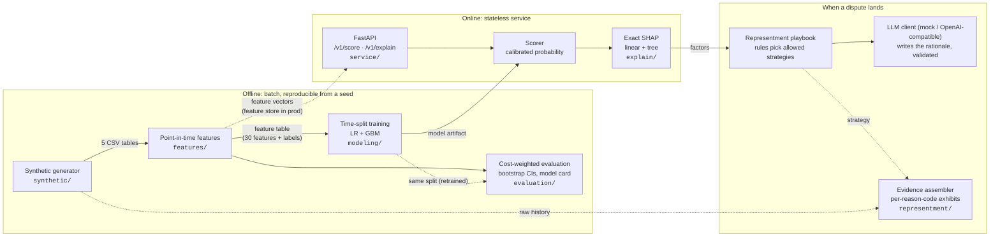
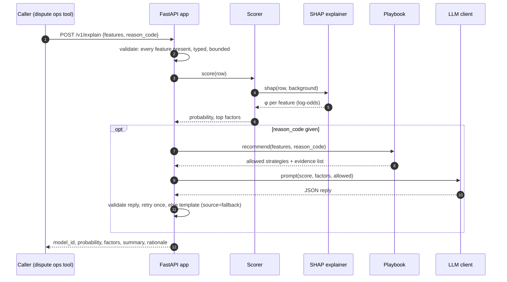

# Architecture

How the pieces of `chargeback-prediction` fit together, what each one owns, and the invariants
that hold across them. Every component is a module under `src/chargeback_prediction/` and a
`cbp` subcommand; `cbp demo` runs them all in order (see [the recording](demo/transcript.txt)).

> All data is synthetic. Nothing here reads real cardholder, merchant or employer data.

## Components and data flow

Solid arrows carry data the next stage reads; dotted arrows are looser couplings (the evaluator
retrains on the same split rather than loading the pickled models, and the service receives
feature vectors from the caller rather than computing them).

| Stage | Module | Input | Output | Owns |
|---|---|---|---|---|
| Generate | `synthetic/` | seed, size, window | `customers`, `subscriptions`, `transactions`, `card_updates`, `disputes` CSVs | personas and the patterns the model must find; label censoring |
| Features | `features/` | the five tables | one row per approved charge: 30 features, `disputed`, `label_mature` | point-in-time correctness |
| Train | `modeling/` | feature table | `model_{logreg,gbm}.joblib`, report, calibration plot | the time split with a 120-day label gap |
| Evaluate | `evaluation/` | feature table | cost report, model card, bootstrap intervals | dollar costs of each decision |
| Explain | `explain/` | model + feature rows | exact SHAP values, ranked factors | additivity: `base + Σ φ = log-odds` |
| Reason | `reasoning/` | score, factors, reason code | rationale, strategy, evidence list | which strategies are *allowed* (playbook) |
| Evidence | `representment/` | raw tables + dispute | response packet, readiness verdict | never claiming evidence it does not hold |
| Serve | `service/` | feature vectors (JSON) | probabilities, factors, rationale | the request contract |

## The `/v1/explain` request path

The model and the SHAP background load once at startup, so a bad artifact fails the deploy
rather than the first request. The LLM is the only network call, sits only on the explain
path, and always has a deterministic fallback.

## Invariants

These hold across module boundaries, and each has a test that fails if it breaks.

1. **Nothing from the future.** Features at time `t` only see events in `[t − window, t)`, and
   prior disputes count by *filing* date, not charge date (`tests/test_features.py`).
2. **Training labels are final.** Train rows end 120 days before the test window starts, so
   every training dispute was filed before the first test charge (`tests/test_modeling.py`).
3. **Decisions are priced, not thresholded.** The cost rule
   `p · C_cb > (1 − p) · C_fd + C_action` needs calibrated `p`, so models are trained without
   class re-weighting and every report carries ECE; the cost curve is checked against brute
   force (`tests/test_metrics.py`, `tests/test_evaluation.py`).
4. **Explanations add up.** SHAP values reproduce each row's log-odds to ~1e-14 and match a
   brute-force enumeration of coalitions (`tests/test_explain.py`).
5. **Rules decide, the LLM explains.** The LLM can soften a strategy to *review* but never
   turn an *accept* into a fight, and cannot cite features it was not shown
   (`tests/test_reasoning.py`).
6. **One contract.** The service schema, the feature catalog and `docs/features.md` are
   generated from, or checked against, the same spec (`tests/test_service.py`,
   `tests/test_features.py`).
7. **Docs don't drift.** The feature table and the demo recording are regenerated in tests
   and compared with the committed copies, and the notebook is executed end to end
   (`tests/test_features.py`, `tests/test_demo.py`, `tests/test_notebook.py`).

## What production would change

| Here | In production |
|---|---|
| Synthetic generator | Event streams from the payment gateway, CRM and dispute feeds from the acquirer |
| Feature table built in batch | Feature store with the same point-in-time definitions, online and offline |
| Two baselines, fixed hyper-parameters | Cross-validated tuning, champion/challenger |
| `cbp monitor` batch report ([monitoring.md](monitoring.md)) | The same PSI and calibration checks on a schedule, per segment, with alert routing |
| Mock LLM by default | Hosted or self-hosted model behind the same `LLMClient` interface, with prompt and reply logging |
| `attach` items in packets | Connectors to 3DS, AVS/CVV, login logs and signed terms |
| One container | Service behind the authorization path's latency budget; explain/reason on the async ops path |
