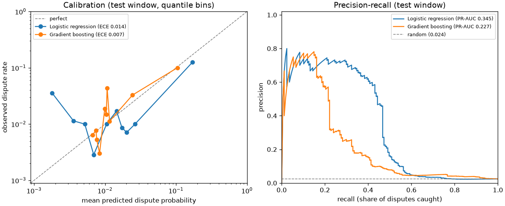

# Baseline model report

<!-- Generated by `cbp train`. Synthetic data only. -->

## Split

| Window | Rows | Disputes | Rate | `created_at` range |
|---|---|---|---|---|
| train | 12,886 | 242 | 1.9% | 2025-01-01 → 2025-07-25 |
| test | 7,013 | 167 | 2.4% | 2025-11-22 → 2026-02-24 |

Label gap: 120 days (8,153 rows dropped between train end and test start); 8,776 rows with an open dispute window excluded.

## Headline metrics (test window)

| Model | PR-AUC | Lift vs. base rate | Brier | ECE | Fit time |
|---|---|---|---|---|---|
| Logistic regression | 0.345 | 14.5× | 0.0179 | 0.0137 | 0.05s |
| Gradient boosting | 0.227 | 9.5× | 0.0201 | 0.0066 | 0.27s |
| *Random scorer* | 0.024 | 1.0× | 0.0232 | — | — |

## Precision@k (review budget as share of test traffic)

| Model | top 0.5% (k=35) | top 1.0% (k=70) | top 5.0% (k=351) |
|---|---|---|---|
| Logistic regression | P 68.6% · R 14.4% · 29× | P 71.4% · R 29.9% · 30× | P 22.5% · R 47.3% · 9× |
| Gradient boosting | P 74.3% · R 15.6% · 31× | P 51.4% · R 21.6% · 22× | P 17.7% · R 37.1% · 7× |

P = precision, R = share of all test disputes caught, × = lift over random review.

## Calibration (quantile bins)

**Logistic regression**

| Bin | Rows | Mean predicted | Observed rate |
|---|---|---|---|
| 1 | 701 | 0.2% | 3.6% |
| 2 | 702 | 0.4% | 1.1% |
| 3 | 701 | 0.5% | 1.0% |
| 4 | 701 | 0.7% | 0.3% |
| 5 | 701 | 1.1% | 1.0% |
| 6 | 702 | 1.5% | 1.7% |
| 7 | 701 | 1.7% | 0.9% |
| 8 | 701 | 2.0% | 0.7% |
| 9 | 702 | 2.6% | 1.0% |
| 10 | 701 | 17.0% | 12.6% |

**Gradient boosting**

| Bin | Rows | Mean predicted | Observed rate |
|---|---|---|---|
| 1 | 778 | 0.7% | 0.6% |
| 2 | 645 | 0.7% | 0.8% |
| 3 | 757 | 0.8% | 0.5% |
| 4 | 659 | 0.8% | 0.3% |
| 5 | 696 | 1.0% | 1.9% |
| 6 | 673 | 1.0% | 1.5% |
| 7 | 730 | 1.1% | 4.4% |
| 8 | 889 | 1.2% | 1.1% |
| 9 | 488 | 2.4% | 3.3% |
| 10 | 698 | 10.5% | 10.0% |

