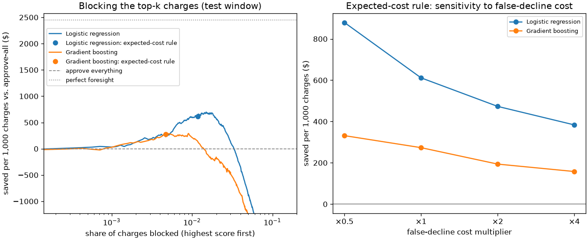

# Cost-weighted evaluation

<!-- Generated by `cbp evaluate`. Synthetic data only; do not edit by hand. -->

Test window: 7,013 charges, 167 disputes (2.4%), 2025-11-22 → 2026-02-24. Intervals are 95% stratified bootstrap (1,000 resamples).

## Cost assumptions

| Assumption | Value |
|---|---|
| Network dispute fee | $25.00 per chargeback |
| Ops handling | $20.00 per chargeback |
| Representment recovery | 25.0% of disputed amount |
| Gross margin lost on a false decline | 80.0% of amount |
| Churn after a false decline | 15.0% × $120 lifetime value |
| Cost of acting on a flag | $0.10 per blocked charge |

So a typical charge of $14.99 costs $56 if it becomes a chargeback and $30 if it is falsely declined; blocking pays off above a dispute probability of 34.9%.

## Headline

| Model | PR-AUC (95% CI) | Expected-cost rule saves per 1k charges (95% CI) | Share of achievable saving |
|---|---|---|---|
| Logistic regression | 0.345 [0.269, 0.431] | $611 [$360, $850] | 24.9% |
| Gradient boosting | 0.227 [0.163, 0.301] | $273 [$117, $437] | 11.1% |

Approving everything costs $2,455 per 1,000 charges; perfect foresight would cost $2. The share of achievable saving is how much of that gap the model's expected-cost rule closes.

## Model comparison (paired bootstrap)

- **Logistic regression − Gradient boosting**: PR-AUC +0.118 [+0.047, +0.194]; saving per 1k charges $338 [$120, $558]. For PR-AUC the difference is unlikely to be resampling noise.

## Logistic regression: blocking policies

| Policy | Blocked | Disputes blocked | False declines | Chargeback cost | False-decline cost | Total | Per 1k charges | Saved vs. approve-all | Residual dispute ratio |
|---|---|---|---|---|---|---|---|---|---|
| Approve everything (no model) | 0 (0.0%) | 0 / 167 | 0 | $17,214 | $0 | $17,214 | $2,455 | $0 | 2.4% |
| Expected-cost rule (per amount) | 82 (1.2%) | 55 / 167 | 27 | $10,771 | $2,147 | $12,927 | $1,843 | $4,288 | 1.6% |
| Fixed review budget (top-k), 1.0% of traffic | 70 (1.0%) | 50 / 167 | 20 | $11,121 | $1,886 | $13,015 | $1,856 | $4,200 | 1.7% |
| Best single threshold, in hindsight (p ≥ 0.256) | 105 (1.5%) | 66 / 167 | 39 | $9,519 | $2,790 | $12,319 | $1,757 | $4,896 | 1.5% |
| Perfect foresight (lower bound) | 167 (2.4%) | 167 / 167 | 0 | $0 | $0 | $17 | $2 | $17,198 | 0.0% |

Disputes blocked by the expected-cost rule, by category:

| Category | Disputes | Blocked | Share |
|---|---|---|---|
| consumer | 103 | 28 | 27.2% |
| fraud | 64 | 27 | 42.2% |

Sensitivity of the expected-cost rule to the false-decline cost (margin and lifetime value scaled together):

| False-decline cost | Blocked | Disputes blocked | False declines | Saved per 1k charges |
|---|---|---|---|---|
| ×0.5 | 104 | 65 | 39 | $879 |
| ×1 | 82 | 55 | 27 | $611 |
| ×2 | 72 | 50 | 22 | $473 |
| ×4 | 67 | 48 | 19 | $384 |

## Gradient boosting: blocking policies

| Policy | Blocked | Disputes blocked | False declines | Chargeback cost | False-decline cost | Total | Per 1k charges | Saved vs. approve-all | Residual dispute ratio |
|---|---|---|---|---|---|---|---|---|---|
| Approve everything (no model) | 0 (0.0%) | 0 / 167 | 0 | $17,214 | $0 | $17,214 | $2,455 | $0 | 2.4% |
| Expected-cost rule (per amount) | 33 (0.5%) | 25 / 167 | 8 | $14,637 | $657 | $15,297 | $2,181 | $1,917 | 2.0% |
| Fixed review budget (top-k), 1.0% of traffic | 70 (1.0%) | 36 / 167 | 34 | $13,346 | $2,357 | $15,710 | $2,240 | $1,505 | 1.9% |
| Best single threshold, in hindsight (p ≥ 0.162) | 63 (0.9%) | 36 / 167 | 27 | $13,346 | $1,823 | $15,176 | $2,164 | $2,039 | 1.9% |
| Perfect foresight (lower bound) | 167 (2.4%) | 167 / 167 | 0 | $0 | $0 | $17 | $2 | $17,198 | 0.0% |

Disputes blocked by the expected-cost rule, by category:

| Category | Disputes | Blocked | Share |
|---|---|---|---|
| consumer | 103 | 0 | 0.0% |
| fraud | 64 | 25 | 39.1% |

Sensitivity of the expected-cost rule to the false-decline cost (margin and lifetime value scaled together):

| False-decline cost | Blocked | Disputes blocked | False declines | Saved per 1k charges |
|---|---|---|---|---|
| ×0.5 | 47 | 29 | 18 | $332 |
| ×1 | 33 | 25 | 8 | $273 |
| ×2 | 29 | 22 | 7 | $194 |
| ×4 | 29 | 22 | 7 | $158 |

